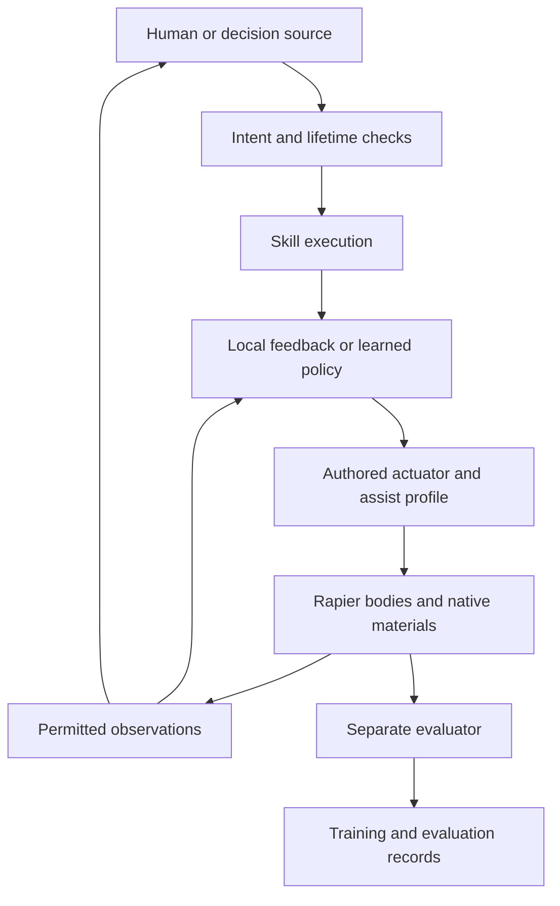

# Proposed architecture

D-010 establishes the Cybersand mission and D-011 establishes plausible gameplay emulation. The structure below is a research proposal under D-012/D-013. It is not implemented, and it does not prescribe a mechanically exact simulator.

## Shared control path

A human or policy can also supply the configured wire/direct action lane through the existing command envelope. It does not need to enter through a mission planner. Different sources are interchangeable at a declared layer; they need not all speak natural language.

The host owns the game state and the authored rules that turn requests into effects. Gyro assistance, soft joints, grip tolerance, damped corrections and deliberate play are part of those rules. The learning system learns how this game behaves. It cannot receive a better assist profile secretly when compared with a human or scripted controller.

## Repository boundary

| Owner | Responsibility | Boundary |
|---|---|---|
| Cybersand | Bodies, contacts, actor/part lifetime, emulated connections, native material/effect ownership, usable mounts and execution | Versioned actor/control/observation contract |
| This repository | Training, demonstrations, offline analysis, evaluation, experiments and policy artifacts | Adapter clients and exported policy bundles |
| Source adapter | Human input, scripted decisions, external model requests and bounded replies | Assigned observation and command/skill surfaces |
| Evaluator | Ground-truth task scoring, coverage, failure classification and aggregate comparison | Isolated records; privileged data never silently fed back |
| Policy runtime | Fixed normalization, inference and recurrent state | Read a permitted observation; return a declared action |

The existing [Thunderbowl contract](https://github.com/techrote/cybersand/blob/b31a897b485a1913a67a02a39fb271495bacf027/docs/systems/thunderbowl-control-reference.md) is the starting point. ACT003 is a sampled motor environment. A source audit and actual host conformance are needed before an adapter claims ACT004 coverage.

## Proposed modules

Keep the existing proposed Python package name `nca` for continuity, but do not make every controller a cellular automaton. These are suggested namespaces, not directories already implemented.

| Namespace | What it owns | First concrete use |
|---|---|---|
| `nca.registry` | Named factories and versioned capability descriptions | Dummy and recorded adapters without importing a trainer |
| `nca.adapters` | Host handshake, stepping, observation copying and action transport | ACT003 reference; ACT004 game adapter when available |
| `nca.profiles` | Rig, sensor, action and authored-assistance manifests | One rig with explicit slots and units |
| `nca.controllers` | Scripted feedback, policy wrappers, small neural models | Baseline, behavioural cloning and recurrent residual comparison |
| `nca.skills` | Initiation, parameters, execution status and termination | Traverse, recover, aim and a usable sequence |
| `nca.data` | Episode records, demonstrations and intervention labels | Replay exact admitted input streams |
| `nca.train` | Replaceable optimization loops | One PPO or imitation implementation before more trainers |
| `nca.eval` | Versioned tasks, scenario splits, metrics and uncertainty | Matched baseline comparison |
| `nca.runs` | Immutable manifests, hashes, budgets and resumable jobs | Every measured or trained run |
| `nca.export` | Model/normalization/action-map bundles and parity checks | Tiny CPU policy before optional quantisation |
| `nca.cellular` | Separate graph/lattice/local-material candidates | Only a scoped T-110 experiment |

Dependency direction matters: importing a host protocol or running a schema check must not require a GPU, a model provider or all optional trainers. Registries reject duplicate IDs and incompatible versions. Start with a few explicit types; do not build a general workflow language.

## Rig and gameplay profile

A profile describes existing authored mechanics, not an anatomy inferred by a neural model:

- Part identities, relative frames, collider geometry and current shape/topology version; up to the configured actor part cap.
- Joint/connection semantics, accepted range, compliance/play and damping behaviour; emulation method identified.
- Available actuator channels, normalization, sign conventions, caps, response rate, held/released behaviour and assist settings.
- Mounted object and usable capabilities, including discrete action semantics, clearance checks and recoil profile.
- Sensor layout, masks, sample cadence, visibility privilege and the meaning of unavailable values.
- Optional resource state such as charge, heat, fuel or effort budget only where the gameplay implements it.

The profile can represent a single body, asymmetric thrusters or a short articulated assembly. A hidden rotor simulation is not required to label an authored gyro assist. A soft end region need not preserve an ideal prismatic constraint exactly.

Render/collider identity and correct actor ownership remain host concerns. Deliberate pose tolerance should be named separately from accidentally drawing a different body.

## Action hierarchy

| Layer | Typical request | Solver and learning consequence |
|---|---|---|
| Task intent | Reach a region; retrieve an object; clear a route | Slow planner chooses a feasible skill and listens for failure |
| Skill parameters | Traverse toward a target at a chosen pace; recover; hold aim | Local policy handles changing contacts and observations |
| Wire lane | Movement/aim/effort/buttons | Existing rig behaviour and assistance remain explicit |
| Direct lane | Named motor/jet/gyro/grip channels or target offsets | Bypasses high-level behaviour only; host caps and authored mechanics remain |
| Host response | Admitted actuator response plus passive/contact motion | It is feedback/evidence, not another command source |

Do not stretch v1's four metal channels to fit every articulated actor. T-101 should propose a versioned manifest/action adapter with padding and masks for learning. Current packet IDs, reserved-channel checks and configured-lane lifetime remain backward compatible.

## State and memory

Policy memory belongs to an actor incarnation and policy/profile version. A shared set of weights does not share hidden state. Reset, actor replacement and incompatible morphology change clear or explicitly remap memory; mount changes invalidate relevant skill assumptions. A model response retains the observation identity on which it was based.

Some useful state can be reconstructed: recent command history helps a policy infer spring compression, traction or assist ramp state. If a hidden gameplay state strongly changes response, either expose it through the declared sensor profile or make recurrence/history an explicit experiment.

## Timing and execution

Retain the existing 60 Hz game/motor and 10 Hz scripted/reflex/NCA schedules as the initial comparison configuration. The nominal policy update interval is six ticks; that is distinct from the current command helper's 12-tick lease and allowed 1–18 tick observation-anchored validity. A training action repeat must declare its duration separately. Later cadence experiments report the exact hold/interpolation, ramping, expiry and input delay.

Slow decisions never block the game. Persistent mission intent, fresh local control and short-lived actuation have different lifetimes. [Command and skill design](design/COMMAND_AND_SKILL_CONTRACT.md) defines proposed extensions while preserving ACT003 behaviour.

A reference game adapter should own one persistent headless host process and step exact configured simulation intervals. The adapter must not advance materials and Rapier through unrelated loops simply because both expose a step function. The [source audit](evidence/2026-10-18-source-prepass.md) explains the host timing gap.

## NCA and distributed experiments

Part graphs, actor graphs and terrain lattices are separate registered candidates. Their observation coverage, recurrent memory, message-passing rounds and latency are declared. Global pooling or team-wide hidden state is a change of information privilege, not a free implementation convenience.

The original intents/hidden-state/signal-field decisions retain relevance for the cellular lane. They do not force an actor pilot to output material-cell edits or use integer arithmetic. Any material-affecting network requests allowed operations from the native owner.

## Delivering a policy

An export bundle includes model weights, normalization, action/profile hashes, supported sensor schema, recurrence/reset rules, inference cadence, dependency/runtime information, evidence and a known compatible host revision. Compatibility rejection is explicit. A fallback is the configured authored controller or neutral behaviour; no model load silently changes the actor's capabilities.

Start with measured CPU inference and a small float reference. Integer export is assessed when it helps deployment. Exact integer network outputs cannot establish exact whole-game replay across different engine builds.
